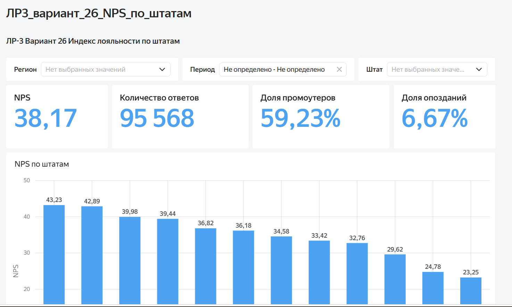
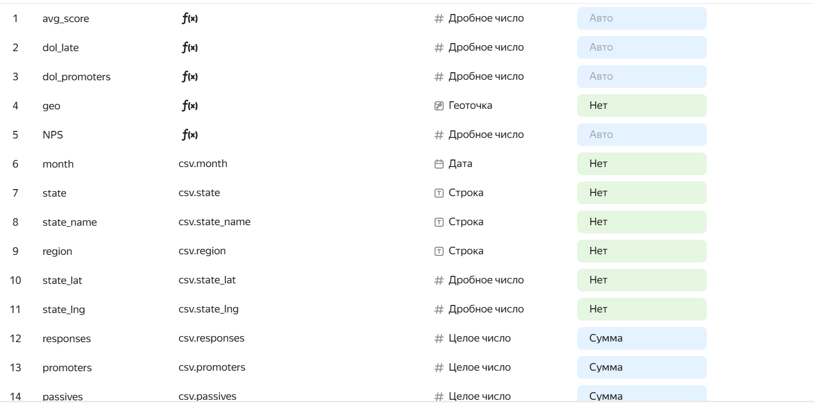
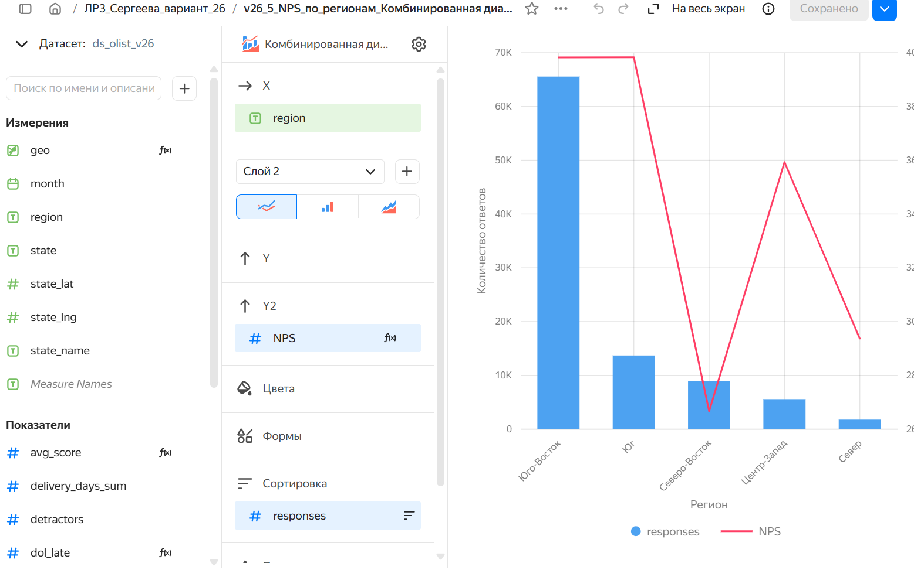
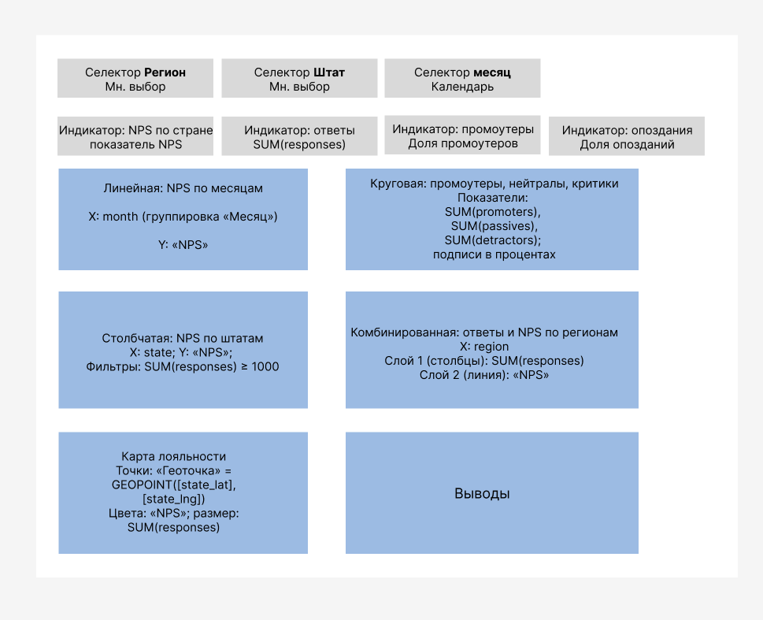

# ЛР-3. Аналитический дашборд для бизнес-кейса — вариант 26

**Студент:** Сергеева А.И. · **группа:** БД-251м
**Бизнес-кейс:** Индекс лояльности (аналог NPS) по штатам

## Цель работы
Какой индекс лояльности по стране и штатам, если «промоутеры» — 5 звёзд, «критики» — 1–3 звезды?

## Бизнес-вопросы, на которые отвечает дашборд
| Потенциальные вопросы бизнеса | Ответ данных |
|---|---|
| Насколько лояльны покупатели в целом? | NPS 38,2; промоутеров 59,2 %, критиков 21,1 % |
| Где лояльность ниже? | Северо-Восток 26,7 и Север 29,4 против 39,8 на Юго-Востоке; худшие штаты BA, CE, RJ |
| Растёт ли лояльность? | Провалы в 11.2017 и 02–03.2018, с 04.2018 — восстановление |
| Что делает покупателя критиком? | Опоздание: вовремя NPS 45, опоздание 1–3 дня −14, 8+ дней −81 |
| Сколько можно вернуть и где? | больше всего — RJ (13,7) |

## Исследуемые метрики
- **NPS** = `(SUM([promoters]) - SUM([detractors])) / SUM([responses]) * 100`
- **Геоточка** = `GEOPOINT([state_lat], [state_lng])`
- **Доля промоутеров** = `SUM([promoters]) / SUM([responses])`
- **Доля критиков** = `SUM([detractors]) / SUM([responses])`
- **Средняя оценка** = `SUM([score_sum]) / SUM([responses])`
- **Доля опозданий** = `SUM([late_orders]) / SUM([responses])`

## Архитектура решения
Kaggle (Olist, 9 CSV) → Python (`urllib`, `pandas`) → SQLite: RAW → STAGING → CORE → витрина `dm_v26_nps_states` → CSV → Yandex DataLens.

## Технологический стек
Python 3.13.18, pandas 2.2.3, SQLite 3.45.1, seaborn 0.13.2, Google Colab / Jupyter, Yandex DataLens.

## Схема данных
Слои: `raw_*` (9 таблиц) → `stg_*` (типизация, очистка) → `core_order`, `core_item`, `dim_state` → `dm_v26_nps_states` (VIEW).
Гранулярность витрины: месяц × штат; строк: 533.

## SQL витрины
```sql
CREATE VIEW dm_v26_nps_states AS
SELECT purchase_month AS month, -- месяц покупки
       customer_state AS state, -- код штата покупателя
       state_name, -- название штата
       region, -- регион
       state_lat, -- широта центра штата
       state_lng, -- долгота центра штата
       COUNT(*) AS responses,  -- ответы
       SUM(CASE WHEN review_score = 5 THEN 1 ELSE 0 END) AS promoters, -- промоутеры: 5 звёзд
       SUM(CASE WHEN review_score = 4 THEN 1 ELSE 0 END) AS passives, -- нейтралы: 4 звезды
       SUM(CASE WHEN review_score <= 3 THEN 1 ELSE 0 END) AS detractors, -- критики: 1–3 звезды
       SUM(review_score) AS score_sum, -- сумма оценок
       SUM(is_late) AS late_orders, -- сколько оценённых заказов пришли позже
       ROUND(SUM(delivery_days), 2) AS delivery_days_sum -- сумма дней доставки
FROM core_order
WHERE order_status = 'delivered' -- только доставленнные заказы
  AND review_score IS NOT NULL -- заказы с отзывом
  AND purchase_month BETWEEN '2017-01-01' AND '2018-08-01' --период
GROUP BY purchase_month, customer_state, state_name, region, state_lat, state_lng
```

## Контрольные значения
| Вопрос | Витрина (SQL) | Независимая проверка (pandas) |
|---|---|---|
| NPS по стране | 38.2 | 38.2 |
| Штат с наименьшим NPS (≥ 1000 ответов) | BA | BA |

## Дашборд DataLens
Ссылка: https://datalens.yandex/nzmq508meppg6?_share_link=public

Селекторы: `region`, `state` (множественный выбор).

| № | Тип | Название | Поля |
|---|---|---|---|
| 1 | Индикатор | NPS по стране | Показатель: «NPS» |
| 2 | Столбчатая диаграмма | NPS по штатам | X: state; Y: «NPS»; Сортировка ↑; Фильтры: SUM(responses) ≥ 1000 |
| 3 | Круговая диаграмма | Промоутеры, нейтралы, критики | Показатели: SUM(promoters), SUM(passives), SUM(detractors) |
| 4 | Линейная диаграмма | NPS по месяцам | X: month; Y: «NPS» |
| 5 | Комбинированная диаграмма | Ответы и NPS по регионам | X: region; Слой 1 столбцы: SUM(responses); Слой 2 линия: «NPS» |
| доп. | Карта | Карта лояльности | Точки: «Геоточка»; Цвета: «NPS»; Размер точек: SUM(responses) |





Прототип дашборда:



## Выводы и бизнес-рекомендации

| Показатель | Что это значит |
|---|---|
| **38,2** | NPS страны: лояльность положительная, но каждый пятый покупатель (21,1 %) — критик |
| **45 и −14** | NPS заказов, доставленных вовремя, и опоздавших всего на 1–3 дня |
| **23,2 %** | доля всех критиков, которую дают 6,7 % опоздавших заказов |
| **−0,92** | корреляция доли опозданий и NPS по 12 крупнейшим штатам |

1. **Лояльность определяет логистика.** Вовремя доставленные заказы дают NPS 45, опоздание на 1–3 дня — уже −13,7, на 8+ дней — −81,3.
2. **Регионы неравны.** Юго-Восток и Юг 39,8, Северо-Восток 26,7 (опоздания 12,5 %, доставка 19,9 дня).
   Худшие крупные штаты — BA 23,2 , CE 24,8, RJ 29,6; лучший — SP 43,2.
3. **RJ — главный резерв роста.** Второй рынок страны (12,7 % ответов) опаздывает в 2,7 раза чаще SP (12,0 % против 4,4 %).
   Устранение опозданий подняло бы NPS RJ на +13,7, а NPS страны — примерно на +1,7.
4. **Провалы NPS совпадают с пиками опозданий.** Ноябрь 2017 (28,5) и февраль–март 2018 (23,1 и 19,9) — месяцы
   с долей опозданий 12–19 %; корреляция по месяцам −0,88. Поэтому за янв–авг 2018 NPS ниже, чем годом раньше (37,9 против 41,5).

**Возможные искажения.** Считаются только доставленные заказы с отзывом: по всем статусам NPS был бы 34,9. У 15 из 27 штатов меньше 1000 ответов, их NPS шумный (RR — 40 ответов), поэтому рейтинг штатов строится с фильтром ≥ 1000.

**Управленческие рекомендации.**
1. Доставка не позже обещанной даты ≥ 95 % (сейчас в этих штатах 86–88 %).
   Ожидаемый эффект: +10…+15 пунктов NPS в этих штатах, и это примерно +2 пункта к NPS страны.
2. **Честный срок для Севера и Северо-Востока**: пока нет регионального склада, увеличить дату доставки.
3. **План мощностей к пикам** (ноябрь, после праздников): резерв перевозчиков и еженедельный мониторинг доли опозданий.
4. **Дашборд как регулярный инструмент**: еженедельно смотреть NPS и долю опозданий по штатам (селекторы `region`, `state`);
5.  Следующий шаг анализа — разобрать 77 % критиков с вовремя доставленными заказами по категориям товаров и текстам отзывов.


